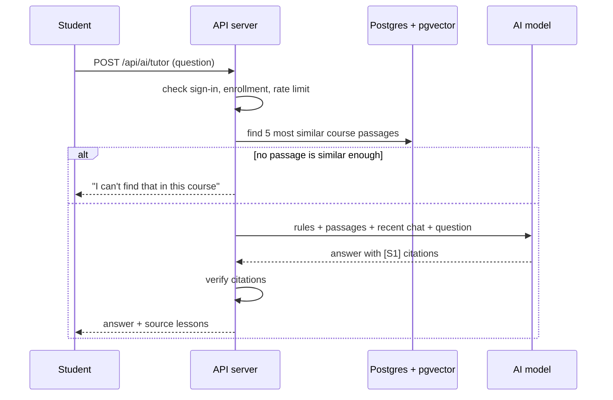

# Diagrams

Add the ER diagram, use case diagram and sequence diagrams here (draw.io, Mermaid or PlantUML).
The data model to draw from is `server/prisma/schema.prisma`. The use cases are listed in section 8 of the SRS.

A starting point for the AI tutor sequence, in Mermaid:

